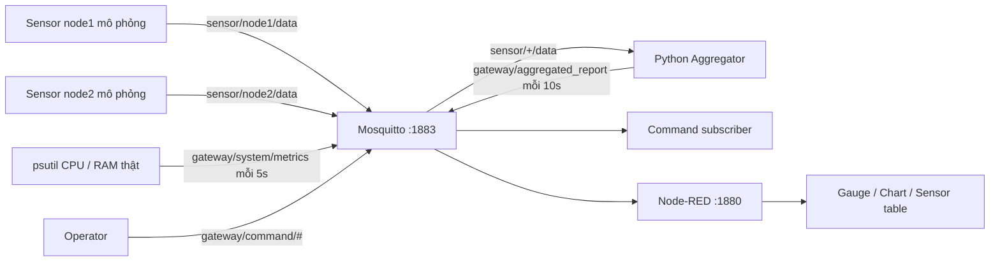

# Lab 5 — Local MQTT Gateway

Đã thực hiện 5 bài trên lớp và 3 bài về nhà trong `Lab 5_1.docx`.
Máy thực thi là Windows; Mosquitto chạy trực tiếp bằng bản Windows chính thức.
CPU/RAM là số đo thật của máy này. Hai node cảm biến được mô phỏng bằng Python vì chưa có thiết bị cảm biến vật lý.
Hướng dẫn Linux/Raspberry Pi tương đương nằm ở cuối tài liệu.

## Thư mục riêng cho từng bài

Mỗi bài có `README.md` và các tệp chạy/cấu hình riêng. Mã nguồn Python chính nằm trong thư mục bài; `gateway/common.py` là kết nối MQTT dùng chung. Các lệnh `python -m gateway...` vẫn hoạt động.

```text
lab5/
├── Tren_lop/
│   ├── Bai_1/  # Mosquitto: mosquitto.conf, chay.ps1
│   ├── Bai_2/  # CLI: nhan.ps1, gui.ps1
│   ├── Bai_3/  # check_connection.py, chay.ps1
│   ├── Bai_4/  # metrics_publisher.py, chay.ps1
│   └── Bai_5/  # command_subscriber.py, chay.ps1, gui_lenh.ps1
├── Ve_nha/
│   ├── Bai_1/  # aggregator.py, sensor_simulator.py, script chạy
│   ├── Bai_2/  # cau_hinh_bao_mat.py, acl, cấu hình mẫu, kiem_tra.ps1
│   └── Bai_3/  # flows.json, settings.js, chay.ps1
├── Bao_cao/
│   └── Bao_cao_Lab_5.docx
├── gateway/    # Kết nối chung và các lệnh tương thích
├── config/     # Cấu hình thực tế, tài khoản và mật khẩu băm
├── node-red/   # Môi trường Node-RED dùng chung
├── scripts/    # Cài đặt, quản lý, tạo flow và báo cáo
├── tests/      # Kiểm thử MQTT/dashboard
└── reports/    # Kết quả kiểm thử, ảnh và bản báo cáo tương thích
```

| Phần | Hướng dẫn |
| --- | --- |
| Trên lớp | [Bài 1](Tren_lop/Bai_1/README.md), [Bài 2](Tren_lop/Bai_2/README.md), [Bài 3](Tren_lop/Bai_3/README.md), [Bài 4](Tren_lop/Bai_4/README.md), [Bài 5](Tren_lop/Bai_5/README.md) |
| Về nhà | [Bài 1](Ve_nha/Bai_1/README.md), [Bài 2](Ve_nha/Bai_2/README.md), [Bài 3](Ve_nha/Bai_3/README.md) |
| Báo cáo Word | [Bao_cao_Lab_5.docx](Bao_cao/Bao_cao_Lab_5.docx) |

Ví dụ chạy riêng bài 3 từ thư mục gốc lab và tạo lại báo cáo:

```powershell
powershell -ExecutionPolicy Bypass -File Tren_lop\Bai_3\chay.ps1
.\.venv\Scripts\python.exe scripts\build_report.py
```

Các môi trường và tài khoản được dùng chung; không cần cài thư viện riêng cho từng bài. Đọc README của mỗi bài để biết broker cần chạy trước và kết quả cần quan sát.

## Chạy nhanh trên máy hiện tại

Hệ thống được khởi động sau khi hoàn thành bài. Mở:

- Dashboard: <http://127.0.0.1:1880/dashboard/gateway>
- Node-RED editor: <http://127.0.0.1:1880/>
- MQTT broker: `127.0.0.1:1883`, bắt buộc tài khoản.

Trong PowerShell tại `C:\IOT\lab5`:

```powershell
# Xem các tiến trình của bài lab
.\.venv\Scripts\python.exe scripts\manage.py status

# Dừng / khởi động lại
powershell -ExecutionPolicy Bypass -File scripts\stop.ps1
powershell -ExecutionPolicy Bypass -File scripts\start.ps1

# Cài lại môi trường khi cần, sau khi dừng bài lab
powershell -ExecutionPolicy Bypass -File scripts\setup.ps1
```

Các tiến trình chạy nền, không tự chạy khi khởi động Windows. Nhật ký ở `logs/`.
Script dừng kiểm tra PID và thời điểm tạo tiến trình trước khi kết thúc tiến trình thuộc bài lab.

## Các bài đã thực hiện

| Bài | Mã nguồn/cấu hình | Kết quả |
| --- | --- | --- |
| Trên lớp 1 | `Tren_lop/Bai_1/mosquitto.conf` | Mosquitto thật, cổng 1883 |
| Trên lớp 2 | `Tren_lop/Bai_2/nhan.ps1`, `gui.ps1` | Nhận đúng `Hello Local MQTT` tại `gateway/test` |
| Trên lớp 3 | `Tren_lop/Bai_3/check_connection.py` | Paho callback API v2, chờ CONNACK thành công |
| Trên lớp 4 | `Tren_lop/Bai_4/metrics_publisher.py` | CPU, RAM thật; JSON; chu kỳ 5 giây |
| Trên lớp 5 | `Tren_lop/Bai_5/command_subscriber.py` | Subscribe `gateway/command/#`, in lệnh nhận được |
| Về nhà 1 | `Ve_nha/Bai_1/aggregator.py` | Subscribe `sensor/+/data`, tổng hợp mỗi 10 giây |
| Về nhà 2 | `Ve_nha/Bai_2/cau_hinh_bao_mat.py`, `acl` | Tắt anonymous, mật khẩu băm, phân quyền theo tài khoản |
| Về nhà 3 | `Ve_nha/Bai_3/flows.json`, `settings.js` | MQTT in, 2 Gauge, Chart CPU/RAM, bảng sensor tại cổng 1880 |



## Bài 1–2: broker và CLI

Chế độ ban đầu cho bài 1–2 dùng anonymous **chỉ trên loopback**. Dừng hệ thống trước để tránh chiếm cổng 1883:

```powershell
powershell -ExecutionPolicy Bypass -File scripts\stop.ps1
.\tools\mosquitto\mosquitto.exe -c config\mosquitto-local.conf -v
```

Mở hai terminal khác tại thư mục lab:

```powershell
# Terminal nhận
.\tools\mosquitto\mosquitto_sub.exe -h localhost -t gateway/test -v
```

```powershell
# Terminal gửi
.\tools\mosquitto\mosquitto_pub.exe -h localhost -t gateway/test -m 'Hello Local MQTT'
```

Subscriber hiện `gateway/test Hello Local MQTT`. Kết thúc broker và subscriber bằng Ctrl+C, rồi chạy `scripts/start.ps1` để trở lại cấu hình bảo mật.

Khi hệ thống bảo mật đang chạy, thử bằng tài khoản operator:

```powershell
.\.venv\Scripts\python.exe scripts\mqtt_cli.py sub -t gateway/test -v
# Ở terminal khác
.\.venv\Scripts\python.exe scripts\mqtt_cli.py pub -t gateway/test -m 'Hello Local MQTT'
```

## Bài 3–5: Python gateway

Môi trường `.venv` chứa `paho-mqtt` và `psutil`; không cần activate khi dùng đường dẫn Python đầy đủ.

```powershell
.\.venv\Scripts\python.exe -m gateway.check_connection
.\.venv\Scripts\python.exe -m gateway.metrics_publisher
.\.venv\Scripts\python.exe -m gateway.command_subscriber
```

`start.ps1` đã chạy các chương trình này; chỉ chạy riêng khi muốn quan sát ở terminal hoặc đã dừng tiến trình tương ứng.
`--count 3` cho publisher chạy hữu hạn. `--anonymous` dùng với broker bài 1–2; các chương trình mặc định dùng tài khoản `gateway`.

Ví dụ JSON của `gateway/system/metrics`:

```json
{
  "gateway_id": "ten-may",
  "timestamp": "2026-10-20T00:00:00+00:00",
  "cpu_percent": 20.1,
  "ram_percent": 65.0,
  "ram_used_bytes": 10979000320,
  "ram_total_bytes": 16891633664
}
```

Đây là ví dụ cấu trúc; số đo thực nghiệm nằm trong `reports/test-results.json` và `logs/metrics.log`.

Gửi lệnh, rồi xem `logs/commands.log`:

```powershell
.\.venv\Scripts\python.exe scripts\mqtt_cli.py pub -t gateway/command/led -m LED_ON
Get-Content logs\commands.log -Tail 10
```

Chương trình in lệnh nhận được. Bài lab chưa có thiết bị chấp hành vật lý để bật/tắt LED.

## Về nhà 1: tổng hợp cảm biến

```powershell
.\.venv\Scripts\python.exe -m gateway.aggregator
.\.venv\Scripts\python.exe -m gateway.sensor_simulator --node node1
.\.venv\Scripts\python.exe -m gateway.sensor_simulator --node node2
# Theo dõi kết quả ở terminal khác
.\.venv\Scripts\python.exe scripts\mqtt_cli.py sub -t gateway/aggregated_report -v
```

Mỗi cửa sổ 10 giây lưu bản tin JSON hợp lệ mới nhất của từng node. Nếu node gửi nhiều lần, bản tin sau thay bản tin trước; `message_count` vẫn đếm tất cả bản tin hợp lệ nhận được.
`nodes` chứa dữ liệu theo node, `received_at` ghi thời điểm gateway nhận. Mỗi lần publish thành công mở cửa sổ mới; cửa sổ không có dữ liệu vẫn gửi `node_count: 0`.
JSON hỏng, payload không phải object, NaN và dữ liệu không phải UTF-8 bị bỏ qua và ghi log. Khóa đồng bộ bảo vệ bộ đệm giữa luồng MQTT và luồng tổng hợp. Nếu publish thất bại, dữ liệu được đưa lại vào bộ đệm; chưa có cơ chế lưu bền khi mất điện.

## Về nhà 2: xác thực và ACL

`scripts/prepare.py` tạo mật khẩu ngẫu nhiên cho mỗi tài khoản, rồi dùng **mosquitto_passwd -U** để chuyển tệp mật khẩu thành các hash có salt.
`config/mosquitto-secure.conf` dùng `allow_anonymous false`, `password_file` và `acl_file`.

| Tài khoản | Quyền |
| --- | --- |
| gateway | Publish metrics/report; subscribe command và sensor |
| dashboard | Chỉ đọc metrics/report |
| operator | Đọc/ghi `gateway/test`; gửi command; đọc metrics/report |
| node1 | Chỉ publish `sensor/node1/data` |
| node2 | Chỉ publish `sensor/node2/data` |

Thông tin đăng nhập cục bộ: `config/credentials.json`; mật khẩu băm: `config/passwords`.
Không đưa các tệp chứa mật khẩu vào bài nộp công khai. Flow chia sẻ `node-red/flows.json` không chứa mật khẩu; credentials của Node-RED nằm trong tệp riêng.
Chạy lại prepare giữ nguyên tài khoản hiện tại; dừng hệ thống trước khi chạy để tránh ghi lại cấu hình khi dịch vụ đang dùng.

Ví dụ tạo mật khẩu thủ công theo yêu cầu của đề:

```powershell
# Lệnh minh họa quản trị; nhập mật khẩu tương tác, không cần chạy để thử hệ thống đã tạo
.\tools\mosquitto\mosquitto_passwd.exe -c config\passwords-example demo
```

Kiểm tra từ chối anonymous và mật khẩu sai:

```powershell
.\tools\mosquitto\mosquitto_pub.exe -h 127.0.0.1 -t gateway/test -m denied
.\tools\mosquitto\mosquitto_pub.exe -h 127.0.0.1 -u gateway -P sai-mat-khau -t gateway/test -m denied
# node1 đăng nhập đúng nhưng không có quyền gửi lệnh
.\.venv\Scripts\python.exe scripts\mqtt_cli.py --role node1 pub -V mqttv5 -q 1 -t gateway/command/led -m denied
```

Kết quả: `not authorised` / `Not authorized`. Kiểm thử tự động còn xác minh dashboard không publish được metrics.

Muốn thử từ thiết bị LAN: dừng broker hiện tại, chạy Mosquitto với `config/mosquitto-lan.conf`, trỏ client vào IPv4 LAN của gateway và dùng tài khoản đúng. Cấu hình này đã được sinh sẵn với `listener 1883 0.0.0.0`; chưa mở firewall hoặc kiểm thử với máy khác. Cổng 1883 của bài lab chưa dùng TLS.

## Về nhà 3: Node-RED dashboard

- Node-RED 5.0.8, FlowFuse Dashboard 1.33.0 (Dashboard 2.0).
- Flow có sẵn và tự triển khai khi Node-RED khởi động; không cần import thủ công.
- MQTT in `gateway/system/metrics` → tách CPU/RAM → 2 Gauge 0–100% và biểu đồ lịch sử 10 phút.
- MQTT in `gateway/aggregated_report` → tóm tắt cửa sổ và bảng dữ liệu cảm biến.
- Dashboard và MQTT hoạt động trên máy cục bộ, không gửi telemetry lên cloud.
- Có thể import `node-red/flows.json` lên Node-RED khác, sau đó nhập tài khoản dashboard trong MQTT broker node và Deploy.

Node-RED editor hiện chỉ lắng nghe `127.0.0.1`. npm audit phát hiện 5 vấn đề ở các thư viện được bundle bên trong gói npm phụ thuộc của Node-RED; `npm audit fix` chưa sửa được chúng. Chi tiết lưu tại `reports/npm-audit.json`.

## Kiểm thử và bằng chứng

```powershell
# Broker kiểm thử riêng tại 18884/18885; không đụng cấu hình demo ở 1883
.\.venv\Scripts\python.exe tests\integration.py

# Kiểm tra giao diện, khi hệ thống demo đang chạy
# Cần playwright-core ở tools/browser và Brave; có thể đặt BROWSER_PATH cho Chromium khác
node tests\dashboard.cjs
```

- `reports/test-results.json`: kết quả MQTT, số đo thực và khoảng cách thời gian thực nghiệm.
- `reports/dashboard-results.json`: HTTP, dữ liệu dashboard, lỗi JavaScript nếu có.
- `reports/dashboard.png`: ảnh giao diện khi có dữ liệu.
- `reports/Bao_cao_Lab_5.docx`: báo cáo thực hành.
- `logs/test-*.log`: nhật ký broker/client kiểm thử.

## Chạy trên Linux / Raspberry Pi

Phần Linux dưới đây là hướng dẫn triển khai tương ứng, chưa được thực thi trên thiết bị Linux trong phiên làm việc này.
Sao chép mã nguồn, `requirements.txt`, thư mục `Tren_lop`, `Ve_nha`, `config`, `scripts`, `gateway`, `node-red` (không sao chép `.venv` và `node_modules` của Windows).

```bash
sudo apt update
sudo apt install -y mosquitto mosquitto-clients python3-venv python3-pip
sudo systemctl status mosquitto --no-pager
python3 -m venv .venv
source .venv/bin/activate
pip install -r requirements.txt

# Cần Node.js bản được Node-RED hỗ trợ và npm trước bước này
npm ci --prefix "$PWD/node-red"
python scripts/prepare.py

# Cài tệp broker vào đúng vị trí mà dịch vụ mosquitto đọc được
sudo install -m 640 -o root -g mosquitto config/passwords /etc/mosquitto/lab5-passwords
sudo install -m 640 -o root -g mosquitto config/acl /etc/mosquitto/lab5-acl
sudo tee /etc/mosquitto/conf.d/lab5.conf >/dev/null <<'EOF'
listener 1883 127.0.0.1
allow_anonymous false
password_file /etc/mosquitto/lab5-passwords
acl_file /etc/mosquitto/lab5-acl
EOF
sudo systemctl restart mosquitto
sudo systemctl status mosquitto --no-pager
python -m gateway.check_connection
```

Trong các terminal riêng, activate cùng `.venv` rồi chạy:

```bash
python -m gateway.metrics_publisher
python -m gateway.command_subscriber
python -m gateway.aggregator
python -m gateway.sensor_simulator --node node1
python -m gateway.sensor_simulator --node node2
node node-red/node_modules/node-red/red.js --userDir "$PWD/node-red" --settings "$PWD/node-red/settings.js"
```

Để dùng LAN trên Linux, đổi địa chỉ listener thành IPv4 LAN của gateway hoặc `0.0.0.0`, giữ nguyên yêu cầu xác thực và ACL, rồi restart dịch vụ.

## Tài liệu tham khảo

- [Mosquitto — Download](https://mosquitto.org/download/)
- [Mosquitto — Authentication methods](https://mosquitto.org/documentation/authentication-methods/)
- [Mosquitto — Configuration](https://mosquitto.org/man/mosquitto-conf-5.html)
- [Eclipse Paho MQTT Python](https://eclipse.dev/paho/clients/python/docs/)
- [Node-RED — Windows](https://nodered.org/docs/getting-started/windows)
- [FlowFuse Dashboard — Getting started](https://dashboard.flowfuse.com/getting-started.html)
