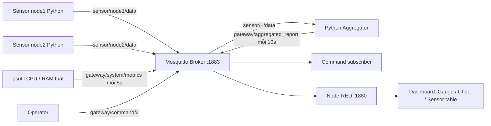

# Lab 5 — Local MQTT Gateway

Hệ thống Local MQTT Gateway hoàn chỉnh triển khai trên môi trường **Windows** (hỗ trợ hướng dẫn tương đương cho **Linux/Raspberry Pi**). Hệ thống thực hiện thu thập dữ liệu hiệu năng máy tính (CPU, RAM), mô phỏng dữ liệu từ các Node cảm biến, tổng hợp dữ liệu và hiển thị trực quan lên **Node-RED Dashboard**.

---

## 1. Cấu trúc thư mục

```text
lab5/
├── Tren_lop/
│   ├── Bai_1/  # Mosquitto: mosquitto.conf, chay.ps1
│   ├── Bai_2/  # CLI: nhan.ps1, gui.ps1
│   ├── Bai_3/  # check_connection.py, chay.ps1
│   ├── Bai_4/  # metrics_publisher.py, chay.ps1
│   └── Bai_5/  # command_subscriber.py, chay.ps1, gui_lenh.ps1
├── Ve_nha/
│   ├── Bai_1/  # aggregator.py, sensor_simulator.py, script chạy
│   ├── Bai_2/  # cau_hinh_bao_mat.py, acl, cấu hình mẫu, kiem_tra.ps1
│   └── Bai_3/  # flows.json, settings.js, chay.ps1
├── Bao_cao/
│   └── Bao_cao_Lab_5.docx
├── gateway/    # Kết nối chung và các lệnh tương thích
├── config/     # Cấu hình thực tế, tài khoản và mật khẩu băm
├── node-red/   # Môi trường Node-RED dùng chung
├── scripts/    # Cài đặt, quản lý, tạo flow và báo cáo
├── tests/      # Kiểm thử MQTT/dashboard
└── reports/    # Kết quả kiểm thử, ảnh và bản báo cáo tương thích
```

---

## 2. Kiến trúc hệ thống



---

## 3. Tóm tắt kết quả các bài thực hành

| Bài | Tên bài | Mã nguồn / Cấu hình chính | Kết quả đạt được |
| :--- | :--- | :--- | :--- |
| **Trên lớp 1** | Cấu hình Broker | `Tren_lop/Bai_1/mosquitto.conf` | Khởi chạy Mosquitto thật trên cổng `1883` thành công. |
| **Trên lớp 2** | Kiểm thử CLI | `Tren_lop/Bai_2/nhan.ps1`, `gui.ps1` | Gửi/nhận thành công chuỗi `"Hello Local MQTT"` qua CLI. |
| **Trên lớp 3** | Python Connection | `Tren_lop/Bai_3/check_connection.py` | Kết nối thành công tới Broker sử dụng **Paho MQTT API v2**. |
| **Trên lớp 4** | Metrics Publisher | `Tren_lop/Bai_4/metrics_publisher.py` | Thu thập và gửi định kỳ dữ liệu JSON CPU/RAM thật mỗi **5 giây**. |
| **Trên lớp 5** | Command Subscriber | `Tren_lop/Bai_5/command_subscriber.py` | Lắng nghe topic `gateway/command/#` và in lệnh nhận được. |
| **Về nhà 1** | Sensor Aggregator | `Ve_nha/Bai_1/aggregator.py` | Gom dữ liệu các node, xử lý loại bỏ JSON lỗi, xuất báo cáo mỗi **10 giây**. |
| **Về nhà 2** | Security & ACL | `Ve_nha/Bai_2/cau_hinh_bao_mat.py`, `acl` | Tắt anonymous, băm mật khẩu, phân quyền chi tiết cho 5 tài khoản. |
| **Về nhà 3** | Node-RED Dashboard | `Ve_nha/Bai_3/flows.json`, `settings.js` | Dashboard hiển thị đồ thị CPU/RAM và bảng dữ liệu cảm biến tại cổng `1880`. |

---

## 4. Danh sách tài khoản & Phân quyền (ACL)

Hệ thống bảo mật nghiêm ngặt thông qua tệp cấu hình `config/mosquitto-secure.conf` với phân quyền:

*   **gateway**: Publish metrics/report; subscribe command và sensor.
*   **dashboard**: Chỉ đọc (subscribe) metrics/report.
*   **operator**: Đọc/ghi `gateway/test`; gửi command; đọc metrics/report.
*   **node1**: Chỉ được phép publish vào topic `sensor/node1/data`.
*   **node2**: Chỉ được phép publish vào topic `sensor/node2/data`.

---

## 5. Hướng dẫn vận hành nhanh (PowerShell)

Mở PowerShell tại thư mục gốc `C:\IOT\lab5`:

```powershell
# 1. Kiểm tra trạng thái các tiến trình chạy nền
.\.venv\Scripts\python.exe scripts\manage.py status

# 2. Khởi động toàn bộ hệ thống (Broker, Publishers, Subscribers, Node-RED)
powershell -ExecutionPolicy Bypass -File scripts\start.ps1

# 3. Dừng toàn bộ hệ thống một cách an toàn (kiểm tra PID)
powershell -ExecutionPolicy Bypass -File scripts\stop.ps1

# 4. Chạy kiểm thử tích hợp tự động
.\.venv\Scripts\python.exe tests\integration.py

# 5. Xuất lại báo cáo kết quả thực hành
.\.venv\Scripts\python.exe scripts\build_report.py
```

---

## 6. Địa chỉ truy cập Dashboard

Khi hệ thống đang vận hành qua lệnh `start.ps1`, truy cập các địa chỉ cục bộ sau:
*   **Giao diện giám sát đồ họa (Dashboard):** [http://127.0.0.1:1880/dashboard/gateway](http://127.0.0.1:1880/dashboard/gateway)
*   **Trình chỉnh sửa luồng (Node-RED Editor):** [http://127.0.0.1:1880/](http://127.0.0.1:1880/)
*   **MQTT Broker Endpoint:** `127.0.0.1:1883` (Yêu cầu xác thực tài khoản)

---

## 7. Hướng dẫn triển khai trên Linux / Raspberry Pi

1. Cài đặt các gói phụ thuộc cần thiết:
   ```bash
   sudo apt update && sudo apt install -y mosquitto mosquitto-clients python3-venv python3-pip
   ```
2. Khởi tạo môi trường ảo và cài đặt thư viện Python:
   ```bash
   python3 -m venv .venv && source .venv/bin/activate
   pip install -r requirements.txt
   npm ci --prefix "$PWD/node-red"
   ```
3. Đồng bộ cấu hình bảo mật vào hệ thống Mosquitto của Linux:
   ```bash
   python scripts/prepare.py
   sudo install -m 640 -o root -g mosquitto config/passwords /etc/mosquitto/lab5-passwords
   sudo install -m 640 -o root -g mosquitto config/acl /etc/mosquitto/lab5-acl
   
   sudo tee /etc/mosquitto/conf.d/lab5.conf >/dev/null <<'EOF'
   listener 1883 127.0.0.1
   allow_anonymous false
   password_file /etc/mosquitto/lab5-passwords
   acl_file /etc/mosquitto/lab5-acl
   EOF
   
   sudo systemctl restart mosquitto
   ```
4. Chạy các tiến trình thành phần trong từng Terminal riêng biệt (đã activate `.venv`):
   ```bash
   python -m gateway.metrics_publisher
   python -m gateway.command_subscriber
   python -m gateway.aggregator
   python -m gateway.sensor_simulator --node node1
   python -m gateway.sensor_simulator --node node2
   node node-red/node_modules/node-red/red.js --userDir "$PWD/node-red" --settings "$PWD/node-red/settings.js"
   ```
